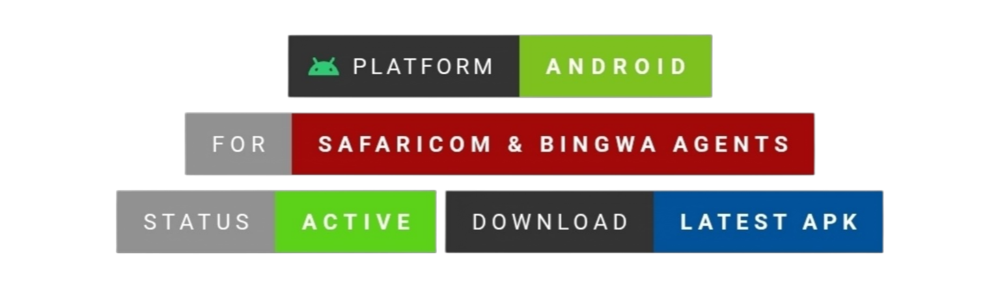

CRUZE AUTOMATE

  

<h3 align="center">Intelligent Automation. Simplified Operations.</h3>

  A smarter way to manage supported USSD workflows, transactions and offers — all from your Android device.

  <a href="https://cruze-automate-website.pages.dev/"><strong>Official Website</strong></a>
  &nbsp; · &nbsp;
  <a href="https://github.com/Cruzebc/cruze-automate-updates/releases/latest/download/CruzeAutomate.apk"><strong>Download APK</strong></a>
  &nbsp; · &nbsp;
  <a href="https://github.com/Cruzebc/cruze-automate-updates/releases"><strong>All Releases</strong></a>

  

  
  
  

Overview

Cruze Automate is an Android application built to simplify supported USSD operations and transaction management.

It combines workflow automation, transaction monitoring and offer management into one application, helping users handle supported mobile operations more efficiently.

Core Capabilities

Feature| Description
USSD Automation| Automates supported USSD workflows using Android Accessibility services.
Training Mode| Helps configure supported USSD workflows.
Execution Engine| Provides advanced execution and retry handling.
Transaction Monitoring| Monitors M-Pesa SMS messages and tracks transactions.
Dual-SIM Support| Supports dual-SIM operations on compatible devices.
Offer Management| Provides tools for managing and transferring offers.
App Updates| Supports application update functionality.

Feature availability depends on device compatibility, Android permissions, SIM configuration, mobile network behaviour and supported USSD services.

Get Cruze Automate

  

  Download the official Android APK and get started.

For previous versions and release information:

"Explore All Releases →" (https://github.com/Cruzebc/cruze-automate-updates/releases)

Installation

1. Download the latest APK using the official download link.
2. Open the downloaded file on your Android device.
3. Allow installation from your browser or file manager if Android requests it.
4. Complete the installation.
5. Open Cruze Automate and grant the permissions required by the features you intend to use.

System Requirements

Requirement| Details
Platform| Android
Minimum Version| Android 6.0 (API 23)
Installation| Android APK
Additional Permissions| Accessibility and SMS-related permissions, depending on features used

Compatibility Notice

Cruze Automate relies on Android system capabilities and supported mobile network services.

Some operations may behave differently depending on:

- Android version and device manufacturer.
- SIM configuration and network availability.
- Accessibility and other required permissions.
- The USSD service being accessed.

Not every USSD workflow is guaranteed to work across all devices and networks.

Official Links

Resource| Link
Official Website| "cruze-automate-website.pages.dev" (https://cruze-automate-website.pages.dev/)
Latest APK| "Download Cruze Automate" (https://github.com/Cruzebc/cruze-automate-updates/releases/latest/download/CruzeAutomate.apk)
Release History| "GitHub Releases" (https://github.com/Cruzebc/cruze-automate-updates/releases)

Security & Permissions

Cruze Automate uses Android permissions to provide its supported functionality.

- Download the application only through official Cruze Automate links.
- Review permission requests before granting access.
- Keep the application updated to access the latest available improvements.
- Never share private signing keys, keystore files, passwords or access tokens.

  <strong>CRUZE AUTOMATE</strong>

  Intelligent Automation. Simplified Operations.

  © Cruze Automate · All rights reserved.

